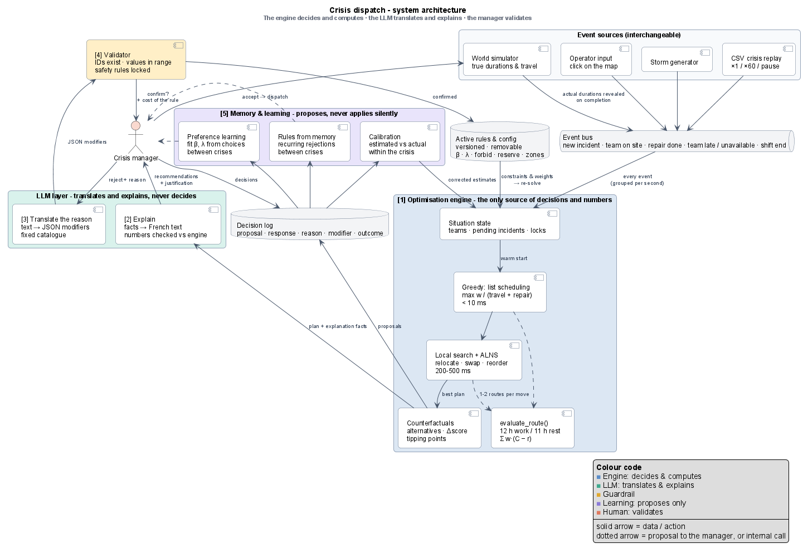

# Pilotage de crise: real-time dispatch of field teams

**Défi Enedis · Hackathon La Mêlée · 9–10 October 2026**

During a climate crisis, many outages hit at once. This project is a **real-time decision-support system** that
recommends which field team should go to which incident, in what order, to restore power as fast as possible for
as many customers as possible (sensitive customers first), under work/rest rules. It explains every recommendation,
and lets the crisis manager accept, modify or reject it.

> **The engine decides and computes · the LLM translates and explains · the manager validates.**



## Quick start

```bash
python -m venv .venv
# Windows: .venv\Scripts\activate    macOS/Linux: source .venv/bin/activate
pip install -e ".[all]"
pytest                                # skeleton tests must pass
streamlit run app/streamlit_app.py    # map of sites + one crisis
```

For the LLM layer: copy `.env.example` to `.env` and set `OPENROUTER_API_KEY` (free models; without a key, templates are used).

### Run the engine

```bash
python bench/run_benchmark.py --crises all --budget-ms 50          # all strategies x 100 crises
python bench/run_benchmark.py --crises every:5 --teams-fraction 0.5  # stress test: half the teams
python bench/reinforcement.py --crisis CRISE_082 --teams-fraction 0.5  # extra teams needed for 90 % at H+48
python bench/optimise_roster.py --offsets 1 2 3 4                   # stage 1: re-optimise the shift schedule
python bench/scenarios.py --budget-ms 30                           # robustness: stress, teams lost, two crises, flood, storm, noise
python bench/calibrate_travel.py                                   # refit the travel model on real OSRM road times
python bench/review_refusals.py --simulate CRISE_051 CRISE_046     # feedback loop demo (simulated refusals)
```

## Status

| Part | State |
|---|---|
| Data loaders, travel times | ✅ implemented |
| Shift schedule (stage 1, fixed at initialisation, 12 h / 12 h, groups A/B) | ✅ implemented (`engine/shifts.py`, `config roster`, `bench/optimise_roster.py`) |
| Decoder, objective, score breakdown | ✅ `engine/evaluate.py` |
| Baselines + Smith rule | ✅ `engine/baselines.py`, `engine/construct.py` |
| Local search (relocate, swap, ruin & recreate), warm start | ✅ `engine/local_search.py`, `engine/planner.py` |
| Operator rules (force, forbid, unavailable, zone, duration, priority, reserve, weight) | ✅ `engine/context.py` |
| Counterfactual (override cost), explanation facts | ✅ `engine/counterfactual.py`, `engine/explain.py` |
| 90 % at H+48 check + reinforcement what-if | ✅ `engine/service.py`, `sim/whatif.py` |
| Event-driven simulator | ✅ `sim/simulator.py` |
| Streamlit UI (replay, recommendations, 48 h check) | ✅ first version |
| **Live session** (step-by-step crisis, accept / reject / confirm, what-if, service check) | ✅ `session.py` |
| **HTTP API** for the front-end | ✅ `api/app.py`, see [docs/API.md](docs/API.md) |
| LLM layer: explanations, refusal reason → rules, validator | ✅ works without a key (templates + rule parser); uses OpenRouter (`nvidia/nemotron-3-super-120b-a12b:free`, Gemma 4 fallback) when `OPENROUTER_API_KEY` is set. Cards: short headline + expandable 2-sentence details + the 3 best paths |
| Knowledge base of decisions, past-refusal hints | ✅ `learning/memory.py` (SQLite, `data/decisions.sqlite`) |
| Periodic expert review → replay test → versioned constraint registry | ✅ `learning/review.py`, `learning/registry.py`, `bench/review_refusals.py` |
| Simulated manager for the demo (synthetic refusals, flagged) | ✅ `learning/simulated.py` |
| Travel times: terrain-aware offline model **calibrated on 3,718 real OSRM trips** (MAE 8.3 min), optional live OSRM with cache | ✅ `data/travel.py`, `bench/calibrate_travel.py` |
| Map layers (GeoJSON: sites, teams, incidents, routes, heat, rule zones) | ✅ `GET /sessions/{id}/map` |
| Robustness scenarios (stress, teams lost, two crises, flood, storm, duration noise) | ✅ `sim/scenarios.py`, `bench/scenarios.py`, `tests/test_scenarios.py` |
| Robust selection under duration noise, en-route diversion, weight learning | ⏳ next |

See [docs/PIPELINE.md](docs/PIPELINE.md) for the engine → LLM → front-end loop and what data crosses each step.
| OR-Tools reference solver + gap measurement (live 3 s plan: +2.3 % on average vs OR-Tools 60 s) | ✅ `engine/reference_ortools.py`, `bench/gap_vs_ortools.py` |

### API

```bash
pip install -e ".[api]"
uvicorn dispatch.api.app:app --reload --app-dir src     # docs at http://localhost:8000/docs
```

## How it works

1. **Events** (new incident, team on site, repair done, team unavailable, shift end) arrive from interchangeable
   sources: CSV crisis replay (×1 / ×60), operator input, a storm generator.
2. The **optimisation engine** re-plans at every event. It builds a plan with a greedy pass (*list scheduling*,
   priority = weighted customers / (travel + repair)), improves it with local search / ALNS within a few hundred
   milliseconds, and computes counterfactuals (cost of each alternative).
3. The **LLM** explains the plan in French, using only numbers produced by the engine.
4. The **manager** accepts, or rejects with a reason. The LLM turns the reason into a structured rule from a fixed
   catalogue. A validator checks it. The engine re-solves and shows what the rule costs.
5. **Learning loops** (all proposals, never silent): duration calibration within the crisis, recurring rejections
   turned into rule proposals, and objective weights learned from the manager's choices.

One full cycle is drawn in [docs/decision_loop.png](docs/decision_loop.png).

**Objective:** minimise `Σ w_i · (C_i − r_i)` with `w_i = customers × (1 + β · sensitive)`, plus stability, travel
and fairness penalties. All weights and rules (12 h work / 11 h rest, one team per incident, …) are in
[`config/default.yaml`](config/default.yaml), never hard-coded.

## Repository layout

```
config/default.yaml         every rule and weight (β, λ, shifts, speeds, solver budget, LLM model)
data/raw/                   organisers' files (never edited), see data/README.md
docs/                       team brief (PDF), engine brief, architecture diagrams (.puml / .png / .svg)
src/dispatch/
  config.py                 load_config()
  data/                     loaders (only code that knows the CSV format), travel times
  engine/                   types (shared contract), modifiers catalogue, evaluate, baselines,
                            construct, local_search, planner, counterfactual, explain, reference_ortools
  sim/                      events, sources (CSV replay, manual, generator), simulator
  copilot/                  Claude client, explanations, reason -> modifiers, validator
  learning/                 calibration, decision memory, preference learning
app/streamlit_app.py        French UI (map, recommendations, active rules)
bench/run_benchmark.py      all policies x all crises, same simulator, same score
tests/                      skeleton tests + engine acceptance tests (skipped until implemented)
```

## Workstreams

| Workstream | Folder | Owner | Reference |
|---|---|---|---|
| Data & travel | `src/dispatch/data/` | | `data/README.md` |
| Optimisation engine | `src/dispatch/engine/` | | [`docs/RO_ENGINE_BRIEF.md`](docs/RO_ENGINE_BRIEF.md) |
| Simulator & event sources | `src/dispatch/sim/` | | brief §5 (contract) |
| LLM copilot & validator | `src/dispatch/copilot/` | | brief §7–§8 |
| Learning loops | `src/dispatch/learning/` | | team brief, section "Self-improvement" |
| Interface | `app/` | | team brief §8 (demo script) |
| Benchmark | `bench/` | | brief §9 (T9–T10) |

## Team conventions

- **Shared contract:** `src/dispatch/engine/types.py` and `engine/modifiers.py`. Change them together, in a dedicated PR.
- **Branches:** `feat/<workstream>-<topic>`, small PRs to `main`, and `pytest` green before merging.
- **No CSV access outside `data/loaders.py`.** No magic numbers outside `config/default.yaml`.
- **Only the engine produces decisions and numbers.** The UI and the LLM display and translate.
- **Python ≥ 3.11**, formatted with `ruff`.

## Documentation

- [Team brief (PDF)](docs/Enedis_Hackathon_Team_Brief.pdf): problem, data, objective, constraints, algorithm, roadmap
- [Optimisation engine brief](docs/RO_ENGINE_BRIEF.md): spec, contract, acceptance tests
- [Architecture](docs/architecture.png) · [Decision loop](docs/decision_loop.png): editable sources in `docs/*.puml`

## Assumptions and limits (to keep in the final README)

Synthetic customer counts and relocated incidents; repair durations known as estimates (the simulator can add noise);
no road blockages unless set by the operator; no network topology (one repair restores one substation); teams are
interchangeable (no skills data).
